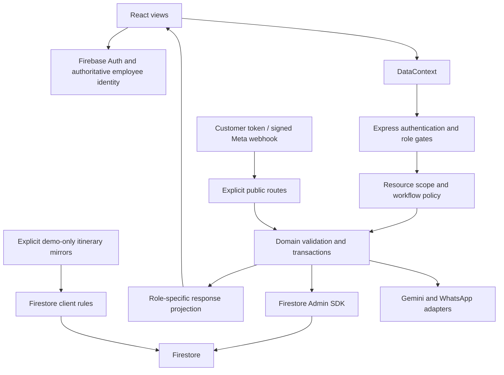

# BBOS architecture review

Audit window: 2026-10-16 to 2026-10-17; Sprint 1 boundary update: 2026-10-20. Evidence is repository code, tests and local execution, not a production assessment.

## Actual architecture

The baseline contains 285 tracked files. A static inventory measured 193 tracked non-test JS/TS source/config files, about 51,637 lines and 372 lexical occurrences of `any` (including comments; not a type-safety score). Critical authentication, policy, money, conversion, supplier, Operations and public-sharing paths were traced separately. These numbers are not a claim of line-by-line manual review of every file.

| Layer | Actual implementation |
|---|---|
| Browser | React 19, Vite 6.4.3 installed, Tailwind 4, Motion, Lucide; `src/main.tsx` → `src/App.tsx` |
| Session | Firebase Auth → `/api/auth/me` → canonical active employee; opt-in local demo identities |
| Client state | Large `DataContext.tsx`: authenticated domain HTTP APIs plus demo localStorage; two demo-only itinerary mirror writes remain |
| HTTP | Express 4 in `server.ts`; 144 registered routes under `server/routes/api.ts` |
| Authorization | Global token/employee resolution, route role gates, resource policy with OWN/TEAM/ALL/ASSIGNED scope, then DTO projection |
| Domains | Trip, Quote, conversion, payment, Reservations, lifecycle, supplier payables, Operations and approval services |
| Persistence | Firebase Admin SDK/transactions behind domain APIs; in-memory adapters and optional demo itinerary mirrors for demo/tests |
| External services | Server-side Gemini; Meta WhatsApp adapter and signed webhook; local customer PDF generation |
| Runtime/build | Bun development/tests; Vite frontend + esbuild ESM backend to `dist/server.js`; no committed CI workflow |

Admin access bypasses Firestore client rules, so API policy remains the production enforcement surface. Sprint 1 removed the legacy browser repository and production client grants; Firestore rule source now denies every enumerated client collection. B05 database selection remains a separate deployment/topology risk.

## Identity and role model

The API verifies Firebase tokens with revocation checking, resolves a unique active employee through firebaseUid or legacy document ID, and uses employeeId as the business identity. Duplicate/missing mappings and unknown/inactive roles fail closed. Production does not trust the role switcher or cached browser profile. API tests cover forged/absent identities and distinct Firebase/business IDs; a real Auth emulator token test passed.

Sales Executive scope is OWN and Sales Manager scope is TEAM. Founder/Admin have broad authority, but Accounts remains a financial role rather than a universal writer. Reservations and Operations use assignments and permitted workflow states. Reservations can read supplier costs for its work without receiving package margin authority. Operations requires a dedicated operational projection. Marketing cannot access the core commercial registries merely by knowing an endpoint.

Production browser workflows no longer rely on UID-keyed employee documents. The rule helpers were removed and client grants deny direct access; API identity continues to treat Firebase UID as authentication identity and employeeId as business identity. The named browser database/default Admin database divergence must still be resolved deliberately before rule deployment or any approved data migration.

## Sprint 1 direct-Firestore inventory

| Classification | Final paths |
|---|---|
| ACTIVE_AND_REQUIRED | No production browser Firestore document read/write remains |
| ALREADY_API_BACKED | Leads/customers, Trips, Quotes, Bookings/services/payments, inventory, conversations/messages, follow-ups, vouchers and audits |
| DEMO_ONLY | `DataContext` mirrors itinerary-day set/delete only when `APP_CONFIG.DEMO_MODE` is true; demo fixtures/localStorage remain |
| TEST_ONLY | Firebase Auth/Firestore emulator setup and synthetic rule regression clients |
| APPARENTLY_UNUSED_REQUIRES_PROOF | Resolved: repository imports, route cases, global search, dynamic references and tests were searched before removing the generic repository plus Company/global Voucher views |
| Server persistence, not browser access | Admin SDK providers under server services and shared server-only storage modules |

The final browser-source scan finds `firebase/firestore` only in Firebase initialization and the demo-only itinerary mirror. Production DataContext has no import from the deleted repository and does not read customers, companies, conversations, messages, tasks, vouchers or historical inventory through the client SDK.

## Business journey and financial review

| Stage | Existing evidence and guarantee | Remaining boundary |
|---|---|---|
| Lead intake/distribution | Server validation, canonical sales ownership, team scoping, transactional distribution/history, repeat-owner handling | Legacy Customer/Company paths still have broader access |
| Package/itinerary | Trip service derives authoritative inventory costs; occupancy, extra bed/child treatment, per-day transport and optional activities have tests | Preview calculators have less uniform input validation than mutation paths |
| Commercial pricing | Shared package calculations retain selling intent, discounts, margin mode and low-margin approval tied to economics | Low-margin threshold configuration needs business review; no arbitrary threshold introduced |
| Quote/version/share | Snapshot/version history, staleness checks, option isolation, immutable public shares, expiry/revocation | Customer free text is not a financial authority; unknown stored-field validation still needs discipline |
| Quote → Booking | Transactional conversion, stale version/updatedAt checks, idempotency, frozen financial snapshot, original sales attribution | Full Firestore adapter/index execution is blocked locally; availability-derived initial confirmations need supplier-policy confirmation |
| Customer money | Integer-minor-unit ledger math, verified-payment aggregates, rejection/void paths and separation of duties | Refund accounting is not equivalent to voiding a record; full refund workflow is absent |
| Reservations | Assigned staff record supplier confirmation and discrepancy evidence; commercial impact is flagged without rewriting frozen economics | Material replacement/amendment approval and execution are incomplete |
| Operations | Assignment, control room, issues/change requests/spend approvals; dispatch/vouchers now scoped and atomic | Operational approval does not itself implement a financial amendment/refund |
| Supplier money | Snapshot-derived obligations; positive amount validation, two-person verification, ledger-derived balances; detail reads repaired | Global summary caps and pending commercial-change integration remain |
| Completion/cancellation | Explicit lifecycle state validation; cancellation preserves notes and audits atomically | Refunds, commissions and end-to-end postconfirmation reconciliation need defined contracts |

Accommodation and transport/activity engines, package commercial math, quote freshness, conversion and payment suites passed. Browser coverage exercises mixed rooms, occupancy, extra children/beds, manual supplier overrides, distinct chargeable vehicle days, multiple vehicles, optional activities, low-margin review and preserved frozen shares. This is strong evidence for those cases, not an independent accounting certification. No tax, rounding, commission or refund policy was invented.

## A01 — Incomplete financial exception journeys

**P1; open; high confidence that interfaces/workflows are incomplete, business behavior requires verification.** No complete audited refund ledger/authorization journey, commission settlement workflow, or versioned postconfirmation amendment executor was found. Discrepancy and operational-change requests exist, but must not be described as applied commercial changes. Conversion can use inventory availability to seed confirmed services; whether that satisfies supplier acknowledgement is a business decision. Do not silently change it.

Acceptance: document permitted transitions and responsible roles; model approved before/after economics and immutable audit; demonstrate supplier unavailability/replacement, changed dates/guests/vehicle, rejected approval, cancellation/refund and commission ownership across transactional integration tests. Effort L; dependencies: approved business rules and potential data migration.

## A02 — Scaling and performance

**P2; open; confirmed code limits plus measured bundle cost.** Supplier summaries scan capped global collections (details now targeted and overflow fails closed). Inventory lists and overlap checks cap at 500; Lead/approval/control-room queries cap at 100 without complete cursor traversal. A large registry can hide actionable records, and truncated overlap searches warrant explicit boundary testing. DataContext eagerly loads many collections and now follows all pages where APIs supply cursors; correctness improved, but initial fetch volume will grow. No 10× load benchmark was run.

Measured production frontend JS: **1,626.91 kB / 397.92 kB gzip**, versus baseline **1,738.31 kB / 427.35 kB gzip**. The difference follows production demo-code exclusion, not a general optimization project. Vite still warns about >500 kB chunks. CSS is 71.64 kB. Module views are eagerly imported; route/domain splitting and paginated visible views are higher-value than speculative micro-optimizations.

Acceptance: scoped cursor pagination/aggregations with >cap fixtures, bounded initial reads, stable financial totals across page boundaries and recorded latency/read counts at representative 10× data. Effort M-L. Missing indexes were inspected as a risk; deployed index effectiveness was not tested.

## A03 — Verification infrastructure

**P2; open; confirmed.** No CI workflow is committed. `bun run lint` executes TypeScript only; no ESLint/formatter validation command exists. Tests are excluded from tsconfig and strict checking is not enabled. Many old rule tests inspect source strings or hardcoded expectations. New executable rule regressions were added, but Java is missing. The full Firebase browser suite also cannot launch Firestore.

Acceptance: pinned local/CI runtimes including Java, successful rule/Firestore integration suite, negative identity/scope tests, typecheck for tests, actual lint command and mandatory checks. Do not convert skipped emulator tests into passes. Effort M.

## A04 — Complexity and duplication

**P2; open; confirmed.** DataContext is 3,535 lines, TripBuilderView 2,112, QuoteService 1,921, TripService 1,643, and the main shared types file 1,167 (measured at audit time). Browser presentation, storage, demo behavior and domain orchestration are coupled. Inventory routes repeat scope/error/projection plumbing; multiple storage serializers and role helpers still exist.

This pass consolidated only the same supplier/profit field classification and operational Booking authorization; it retained distinct Sales, Reservations and Operations financial rules. It added a reusable page reader and a narrow storage serializer. No speculative service rewrite or dead-file deletion occurred; unused-looking legacy code still has migration/runtime uncertainty.

Acceptance: split domain data hooks/adapters and transactional services incrementally behind behavior tests, reduce unsafe casts at external boundaries, and introduce explicit DTOs where the same resource policy is already defined. Effort L; no microservices required.

## A05 — Boundary contracts and resilience

**P2; open; confirmed inconsistencies, exploitability not established.** Mutating commercial services have stronger allowlists than preview/AI endpoints. Some calculators accept loosely typed dates/numbers and return generic 500s for malformed input. Some routes expose `error.message` from internal exceptions. Generic Trip/legacy financial projection remains a denylist, so new aliases can escape unless classified. Raw-body webhook signatures and token-share projection are stronger boundaries.

No application upload/command-execution or unsafe raw-HTML path was identified in the static searches performed; this is not proof that no injection exists. AI receives user-controlled context; tool execution is currently a misleading stub (B10), not a secure completed action pipeline. Outbound timeout/retry budgets, public request throttling and deployment security headers need explicit review; upstream protections were not inspected.

Acceptance: per-route schema contracts, consistent nonrevealing errors, explicit financial DTOs, bounded provider deadlines and idempotent retry tests. Effort M; API semantic changes need review.

## A06 — Frontend accessibility and behavior

**P2; open; confirmed source gaps, broader behavior needs testing.** Sign-in now has labels, autocomplete, error announcement and duplicate-submission protection. Data loading now preserves page completeness and prevents stale commits. Existing browser cases cover critical sales flow, permission views and selected mobile quote/share layouts.

GlobalSearchModal and LeadDetailDrawer use custom overlays without a complete shared dialog/focus-management contract. Icon-only controls and other forms need consistent accessible naming. Keyboard-only operation, focus restoration/trapping, screen-reader behavior, contrast and all responsive breakpoints were not comprehensively tested. No WCAG conformance claim is made.

Acceptance: shared accessible dialog behavior, labeled controls, Escape/Tab/return-focus tests, error announcements and manual assistive-technology review of primary journeys. Effort M. [W3C form-label guidance](https://www.w3.org/WAI/tutorials/forms/labels/) supports the focused sign-in fix.

## Final re-review and scope limits

Reviewed modified policy actions, assignment-before-idempotency ordering, DTO call sites, transaction read-before-write order, rollback behavior, optional-field serialization, UUID generation, rule grants and frontend cleanup. Broad unit/browser tests passed after source edits stopped. Rule denial changes require an emulator run and coordinated release; “source fixed” does not mean production protected.

Not assessed: live IAM/service-account privileges, actual deployment/reverse-proxy configuration, historical document quality, backups/restores, production load, external provider live delivery, exhaustive assistive-technology operation, or complete financial exception policy. Those require environment/business evidence beyond this local repository audit.
