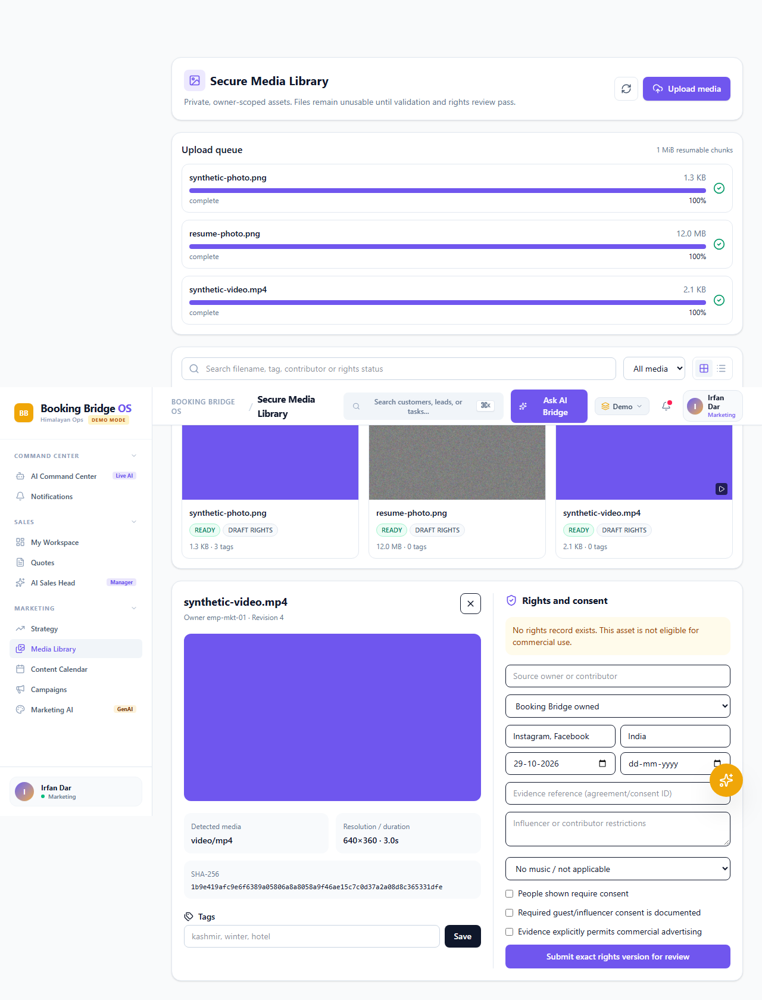
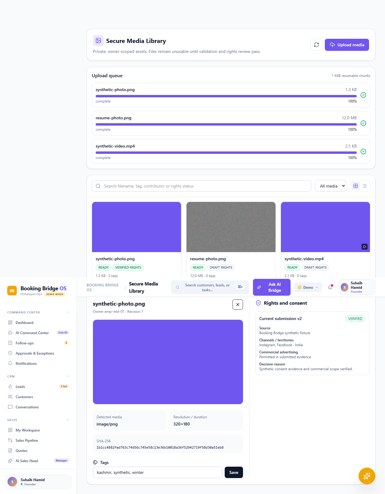

# BBOS Marketing Studio — M1B Secure Media Library

Date: 29 October 2026

Branch: `audit/bbos-comprehensive-remediation`

Verified starting commit: `ef63d920fcd5875a21619274331bc5ce82b9354b`

## Completion verdict

**M1B is closed in source for the isolated nonproduction proof of concept.** Marketing can upload synthetic image and video files, pause/resume/cancel uploads, observe processing, view private previews, manage tags, search the owner-scoped library, submit exact-version rights, and receive an audited Founder/Admin decision. Production storage, production metadata persistence, stronger operating-system worker isolation, and a reviewed server-side video decoder remain prerequisites for deployment or M2.

No production Firebase project, live Meta account, Sembark environment, real lead/customer media, paid cloud resource, publishing endpoint, editor, or campaign service was accessed or created.

## Architecture decisions

### Private object storage

M1B adds a `LocalMediaObjectStorageAdapter` beneath the existing M1A storage interface. It is an isolated filesystem implementation for development and automated verification. The adapter creates opaque server-owned keys under `marketing/quarantine`, `marketing/originals`, and `marketing/derived`; browser-provided object paths are never accepted. Resolved paths must remain below the configured root and reject traversal and Windows alternate-stream syntax.

`BBOS_MEDIA_STORAGE_MODE=local` enables this adapter outside the demo profile, with an optional `BBOS_MEDIA_LOCAL_ROOT`. The server refuses local mode when `BBOS_ENVIRONMENT=production`. Production continues to use the fail-closed unavailable adapter.

The recommended production implementation is a private Google Cloud Storage bucket behind the same interface, using service-account IAM, short-lived object-scoped authorization, uniform bucket-level access, encryption at rest, object lifecycle rules, malware/content inspection, and a regional location selected after data-residency review. `asia-south1` is the working latency preference for the current India-based operation; it is not provisioned or approved by this milestone.

### Upload and reconciliation

- Uppy Core owns browser file selection, queue state, type restrictions, and progress events.
- The BBOS transport issues a one-hour, employee-scoped upload session and transfers exact 1 MiB chunks to a server-generated quarantine object.
- Resume uses the authoritative server byte offset. Offset conflicts fail with the correct resume position.
- Completion checks the declared byte count against stored bytes, computes SHA-256 from the stored object, and creates a processing job.
- Promotion from quarantine to the immutable original namespace occurs only after successful inspection.
- Pause, resume, cancellation, expiry, transport failure, processing failure, and completion have explicit queue/session states.
- Duplicate checksums create a warning; they do not merge assets, ownership, rights, or audit records.

### Processing worker

Inspection and Sharp decoding execute in a spawned Bun worker, outside the interactive Express process. Requests and responses use bounded JSON over standard streams, the worker has a 20-second deadline, temporary directories are deleted, and output size/content is validated before recording derived objects.

The worker checks magic bytes independently of the declared MIME type. Images use Sharp with warning failures, a 50-megapixel input cap, a 12,000-pixel dimension cap, automatic orientation, and a 640×640 WebP result. MP4/MOV inspection streams ISO box headers, requires `moov` plus media data, and derives duration and track dimensions. Videos must be no longer than 10 minutes and no larger than 4K/8,847,360 pixels.

FFmpeg was deliberately not added. M1B does not introduce a broad codec executable before build provenance, patent/licensing, sandbox, update, and vulnerability-management review. For supported browser-decodable videos, the client captures a frame and the server treats it as untrusted input, re-detects it, and normalizes it through the isolated Sharp worker. The original video remains unchanged.

### Identity and access

All media routes use the existing canonical Firebase employee identity resolver. Marketing receives owner-constrained media scope. Founder/Admin may review rights, and Marketing cannot verify its own submission. Preview bytes pass through an authenticated, owner-scoped server route with `private, no-store` and `nosniff`; local filesystem paths are never returned. Unverified, rejected, revoked, expired, or channel/territory-incompatible rights remain commercially ineligible under the M1A policy.

## Storage configuration and cost assumptions

| Control | M1B setting |
| --- | --- |
| Environment | OS temporary directory or explicit isolated local root only |
| Upload session | 1 hour |
| Chunk size | 1 MiB |
| Image maximum | 25 MiB |
| Video maximum | 512 MiB; 10 minutes; 4K/8,847,360 pixels |
| Audio maximum | 100 MiB |
| Client preview input | 8 MiB; JPEG, PNG, or WebP |
| Generated preview | WebP, contained within 640×640 |
| Local retention | Until cancellation/deletion or operator cleanup of the isolated temp root |
| Cloud resources created | None |

The proof of concept has no incremental cloud storage or egress cost. Production cost must be calculated at provisioning from `stored GiB × selected regional storage rate + Class A/B operations + retrieval/egress + worker compute and logs`. A capacity plan needs monthly ingest, retained original/derived ratio, access frequency, legal retention, and recovery requirements before a budget can be stated responsibly. A proposed lifecycle for review is seven days for failed quarantine objects, Standard storage for active originals, and transition/deletion rules for inactive originals and derived previews only after legal and business approval.

## Open-source components

| Component | Pinned version | License | Use and disposition |
| --- | --- | --- | --- |
| `@uppy/core` | 6.3.0 | MIT | Browser selection, restrictions, queue, progress; custom BBOS authenticated resumable transport |
| `sharp` | 0.35.5 | Apache-2.0 | Isolated image metadata and WebP normalization |
| `re2js` | 2.8.7 override | MIT | Firebase Firestore transitive dependency patched for GHSA-gg6h-894w-4m9c |

The live audit discovered `re2js` 2.8.6 affected by the high-severity opt-in lookbehind quadratic-time denial of service advisory. Firebase accepts the compatible patch; the lockfile and narrow override now select 2.8.7. The dependency gate passes with five previously reviewed residual advisories and zero unexpected advisories.

## Implemented workflows

1. Marketing opens **Media Library**, selects a supported synthetic photo or video, and receives a narrow upload session.
2. The queue transfers chunks with visible progress and supports pause, server-offset resume, and cancellation.
3. Server reconciliation hashes and inspects stored bytes. Valid originals become ready; invalid media is rejected and remains unusable.
4. Photo thumbnails are generated server-side. Video frames are normalized server-side after browser capture.
5. Grid/list views, media-type filters, tags, search, checksum, metadata, duplicate warning, processing state, and responsive details are available.
6. Marketing submits ownership, consent, contributor, channel, advertising, territory, evidence, music, influencer, and expiry information for the exact asset version.
7. Founder/Admin records a reasoned verify/reject decision. Immutable rights history remains visible.

## Screenshots

Both screenshots were generated from the synthetic Chromium E2E workflow. They contain no production or customer data.

## Files changed

- `.env.example`, `package.json`, `bun.lock`
- `server/marketing/mediaDomain.ts`
- `server/marketing/mediaStorageAdapter.ts`
- `server/routes/marketingMedia.ts`
- `server/services/marketingMediaService.ts`
- `server/workers/mediaInspectionWorker.ts`
- `src/services/marketing/mediaLibraryApi.ts`
- `src/components/marketing/MarketingMediaLibraryView.tsx`
- `src/App.tsx`, `src/components/layout/AppLayout.tsx`, `src/components/layout/Sidebar.tsx`
- `tests/server/marketing-media-m1b.test.ts`
- `tests/e2e/marketing-media-library.e2e.ts`
- `docs/marketing/screenshots/m1b-media-library.png`
- `docs/marketing/screenshots/m1b-rights-review.png`
- this report

The intentional local `firebase-applet-config.json` modification was preserved and excluded from the M1B commit.

## Verification

| Command | Result |
| --- | --- |
| `bun install --frozen-lockfile` | PASS — 873 installs checked, no changes |
| `bun run verify:repository` | PASS — 344 tracked files at the pre-report gate |
| `bun run verify:audit` | PASS — 5 reviewed residual advisories, 0 unexpected |
| `bun run lint` | PASS — TypeScript no-emit |
| `bun test` | PASS — 746 passed, 8 emulator-only skipped, 0 failed; 2,977 assertions across 57 files |
| Focused M1A/M1B media tests | PASS — 23 passed, 0 failed; 96 assertions |
| `bun run build` | PASS — Vite 1,890 modules plus bundled server |
| `bun run test:e2e` | PASS — 57/57 Chromium tests, including the new M1B journey |
| `bun run test:rules` | PASS — 5/5 on isolated Firestore emulator |
| `bun run test:e2e:firebase` | PASS — 1/1 on isolated Auth + Firestore emulators |
| `git diff --check` | PASS |

Emulator checks used Temurin 21.0.12.1 through a session-only `JAVA_HOME` and the local projects `demo-bbos-audit-rules` and `bbos-qa3-local`. Expected permission-denied and emulator shutdown socket messages were observed during negative assertions and teardown; both commands exited successfully.

The E2E proof covers photo and video upload, an interrupted 12 MiB chunked upload and resume, processing states, persisted reload, private previews, tags/search, rights submission and Founder verification, Sales-role denial, hostile JPEG rejection, cancellation, exact checksum reconciliation, and immutable rejected-rights history.

## Security findings

- Browser-controlled owner, storage path, validation result, checksum, rights decision, and processing state remain non-authoritative.
- Local object keys are server generated and confined beneath the media root.
- Content is detected from bytes; MIME declaration alone cannot promote an original.
- Originals are preserved; previews are separate immutable derived objects.
- Cross-owner reads and unrelated-role access fail closed.
- Invalid media has no valid current version or preview and receives a failed job record.
- Raw upload and preview endpoints have body limits before business logic.
- The local adapter is blocked in production configuration.
- No supplier economics, booking financials, secrets, or customer records are added to media responses.

## Current limitations and production decisions

1. The local demo uses in-memory metadata and temp-directory object storage; restart persistence and orphan reconciliation are not production grade.
2. Production requires a GCS adapter, bucket/IAM design, approved region, quotas, lifecycle rules, backup/recovery policy, monitoring, and cost approval.
3. The spawned worker has bounded time and I/O but is not an OS container with CPU, memory, syscall, filesystem, and network policy. Production must add that isolation.
4. Server-side video frame extraction and editing proxies await a separately reviewed FFmpeg or equivalent supply chain. Browser-captured previews work for browser-decodable files. WebM without verifiable duration/resolution is rejected in this proof of concept.
5. Rights evidence remains an opaque reference. Evidence-file upload, retention, malware scanning, and reviewer retrieval need a dedicated protected object class.
6. Production metadata queries need Firestore indexes, pagination, durable job dispatch, retry monitoring, and atomic object/metadata reconciliation.
7. Storage lifecycle, legal hold, customer deletion, consent withdrawal, and geography require legal/business approval before real media.
8. The existing production bundle-size warning remains; Media Library route-level code splitting should be considered before deployment.

## M2 prerequisites

- Complete and approve the production storage and worker controls above.
- Define an immutable project/render schema that references exact media and rights versions.
- Enforce rights eligibility again at render time and publication time.
- Select and security-review any video decoder/editor executable and its codec/license build.
- Add durable proxy generation, job observability, quotas, deletion/revocation propagation, and disaster recovery.
- Obtain separate authorization before implementing editing, AI generation, scheduling, publishing, Meta integration, campaign spend, or deployment.
