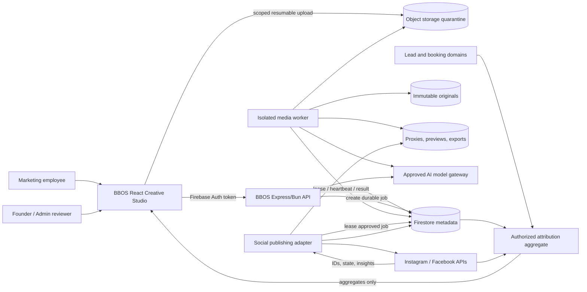
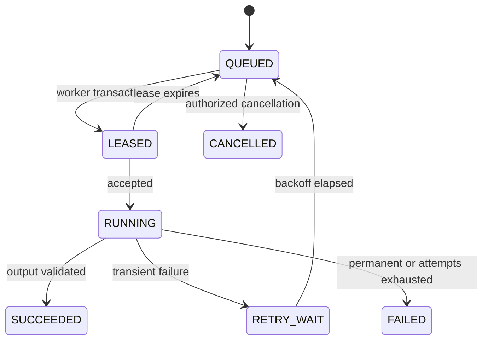
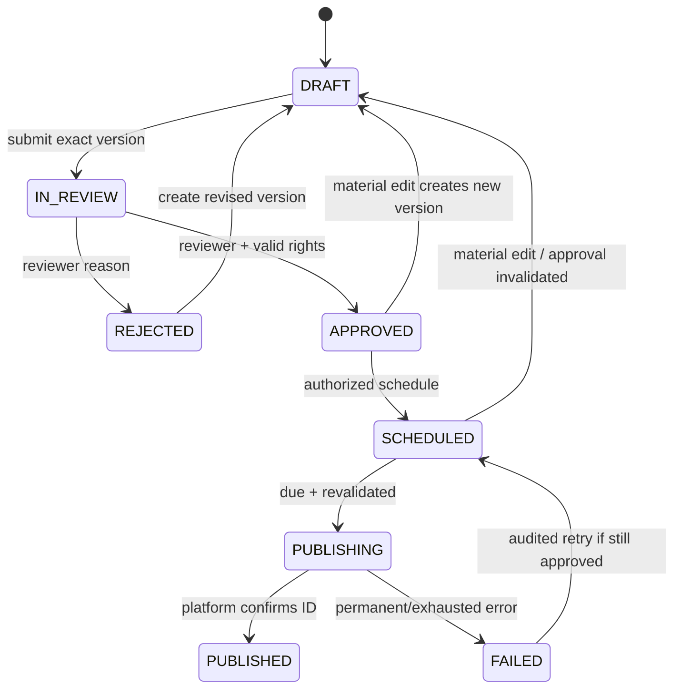

# BBOS Marketing Studio — Recommended Architecture

## Architecture goals

The design keeps BBOS as the control plane and system of record, keeps large media out of Firestore, and keeps untrusted decoding/rendering away from the interactive API. It adds the fewest new deployment units needed for safe asynchronous work.

The MVP does not include a general nonlinear editor, arbitrary user-authored FFmpeg commands, a workflow-automation platform, or a second social-management system of record.

## System context



## Deployment units

| Unit | Responsibility | Explicit boundary |
|---|---|---|
| Existing BBOS web UI | Media library, project editor, review, calendar, publication/analytics views | Never receives social tokens or broad storage credentials; preview is not authoritative export |
| Existing BBOS API | Auth/RBAC, validation, metadata/version writes, upload session issuance, approval and job creation | Never decodes or renders media in the request process |
| Media worker | Inspect, hash, thumbnail, proxy, transcribe, render and validate output | No public inbound endpoint; non-root sandbox; constrained object prefixes and job access |
| Social publishing adapter | OAuth callback/token vault integration, schedule dispatch, Meta container/status/publish/insight synchronization | Can publish only an approved immutable content version; no raw commercial-domain access |
| Attribution aggregate | Join permitted publication/ad/lead/booking facts and expose aggregates | Marketing cannot read raw booking, payment, supplier cost, or customer records |
| Object storage | Quarantine, originals, proxies, previews, exports, rights evidence | Private by default; time-limited scoped access; retention/lifecycle policies by prefix/class |
| Firestore | Metadata, projects, versions, jobs, approvals, publication and metric records | No media binaries or unbounded transcripts/render logs in documents |

Initially the social adapter and attribution code can be separately permissioned modules in the existing server deployment. The render/inspection worker must be separate from day one. Split further only when scale, availability, or secrets justify it.

## Storage layout

Suggested logical object keys, with opaque identifiers rather than user filenames:

```text
marketing/quarantine/{tenantId}/{uploadSessionId}/{objectId}
marketing/originals/{tenantId}/{assetId}/{sha256}/{objectId}
marketing/proxies/{tenantId}/{assetVersionId}/{profile}/{objectId}
marketing/thumbnails/{tenantId}/{assetVersionId}/{size}/{objectId}
marketing/renders/{tenantId}/{projectVersionId}/{renderProfile}/{renderId}
marketing/rights-evidence/{tenantId}/{rightsRecordId}/{objectId}
```

Originals are immutable. Promotion from quarantine occurs only after validation. Generated objects record input hashes, tool/build versions, normalized render specification hash, and checksum. Object deletion is mediated by retention/legal-hold policy, never by accepting a client-provided path.

Signed URLs are short-lived bearer credentials. BBOS binds issuance to the current user, allowed action, exact object, content type/length where supported, and an audit/request ID. Publishing URLs must exist only long enough for platform ingestion and must not expose the original when a publication derivative suffices.

## Core records

Names are conceptual; final collection names must follow existing repository conventions.

| Record | Key fields and invariants |
|---|---|
| `media_assets` | tenant, owner, display metadata, lifecycle state, active asset version, tags, createdBy; no binary |
| `media_asset_versions` | immutable object reference, SHA-256, detected MIME/container/codecs, bytes, duration, dimensions, checksum, validation state, derived-object refs |
| `media_rights` | asset/version, rights type, owner/contributor, consent, source/license, channels, territory, valid-from/to, evidence ref, restrictions, verification actor/time, status |
| `creative_projects` | owner/team, purpose, platform targets, current editable version, state, optimistic concurrency revision |
| `creative_project_versions` | immutable normalized composition JSON, referenced immutable asset versions and rights snapshots, caption/copy, brand-template version, parent version, content hash |
| `brand_templates` | versioned safe zones, fonts, colors, logos, overlay definitions and allowed editable parameters |
| `ai_generations` | purpose, model/version, prompt-template version, source record refs/hashes, output, claim flags, actor, timestamps, safety outcome |
| `approval_requests` | exact project/content version, rights snapshot hash, destinations, reviewer, status, decision reason/time; approvals cannot move to a new version |
| `media_jobs` | type, immutable input/version, normalized parameters, idempotency key, state, attempt, maxAttempts, lease owner/expiry, progress, result/error class |
| `social_connections` | account metadata, token-vault reference, granted scopes, connection health, expiry/re-auth state; no plaintext token |
| `publication_jobs` | approved version, connection/destination, schedule, idempotency key, state, attempt, platform container/post IDs, last reconciliation |
| `metric_snapshots` | platform IDs, metric definition/version, window, observedAt, value, source/freshness; append-oriented snapshots |
| `attribution_aggregates` | report scope/window, attribution method, direct/ambiguous/unattributed counts, lead/booking aggregates, authorized contribution metric, currency, freshness |
| `audit_events` | actor/service, action, target and version, before/after hashes or state, reason, correlation/request ID, time; append-only and access controlled |

Large transcript segments can be stored as compressed private objects with a bounded searchable summary/segment index in Firestore. Firestore documents must remain within size and query-cost limits.

## Composition and rendering contract

A project version is declarative data, not executable code. The schema allows a bounded set of tracks, clips, image layers, text, subtitles, audio, transitions, transforms, and approved effects. Every duration, coordinate, font, color, gain, crop, input asset, and output profile is validated server-side.

The browser uses proxies and Konva to approximate the output. The worker converts the validated schema into an argument array for an approved FFmpeg build. It never invokes a shell or accepts filter text, URLs, protocols, file paths, or command fragments from a client. Final output is authoritative and receives automated checks for duration, dimensions, frame/audio presence, container/codec, loudness bounds, safe-zone warnings, and checksum.

Supported first-release operations:

- trim, split represented as clip ranges, reorder, and simple crossfade/cut;
- 9:16, 1:1, and 16:9 templates with scale/crop and manual focal position;
- image/video/logo/text layers with constrained animation presets;
- caption track editing and burned-in subtitle style presets;
- cleared audio selection, trim/fade, gain and loudness normalization;
- modest exposure/saturation/contrast presets;
- proxy preview, final render, downloadable export and publication derivative.

Stabilization, semantic reframing, multi-camera editing, advanced masks/keyframes, generative video, and arbitrary effects remain outside the MVP.

## Job lifecycle and recovery



Job creation uses a unique idempotency key derived from job type, immutable input/version hash, and normalized parameters. A Firestore transaction grants a time-limited lease. The worker heartbeats; an expired lease can be recovered. Output is written to a unique temporary key, verified, then atomically represented as complete in metadata. Replayed jobs detect a matching verified output and return it rather than duplicate work.

Failures are classified as validation, rights/policy, unsupported media, transient infrastructure, quota/resource, worker defect, or unknown. Only transient and selected quota failures automatically retry with bounded exponential backoff and jitter. Operators see actionable errors without raw secrets, paths, tokens, or unbounded stderr. Dead-lettered jobs require an audited retry or cancel action.

Queue depth, oldest-job age, attempt count, lease expiry, render duration, rejection reason, storage bytes, and publication reconciliation lag are monitored. Per-user/tenant quotas and global concurrency create backpressure.

Firestore-backed jobs are sufficient at initial scale and minimize infrastructure. If contention or throughput outgrows them, introduce a managed queue while retaining `media_jobs` as the durable audit/status record.

## Media security controls

1. Upload allowlist covers declared types and maximum bytes; server detection covers magic, container and streams.
2. Quarantine objects cannot be previewed, downloaded by normal users, rendered, or published.
3. Decode occurs in a patched, minimal image with non-root UID, read-only root filesystem, temporary workspace, no host mounts, no public inbound access, no unnecessary egress, and hard CPU/memory/disk/time/process limits.
4. Network protocols and unsafe/unneeded demuxers/encoders are disabled where practical. Tool builds and model weights are pinned and hashed.
5. Image pixel count, video duration/resolution/frame rate/stream count, archive nesting, and derived-output size are bounded before expensive work.
6. Filenames and embedded metadata are untrusted display data. Logs/UI escape them; object keys are generated.
7. Optional malware scanning occurs before promotion, based on organizational risk policy.
8. Rights status, consent, channel, territory, expiry, and source asset versions are rechecked when review is submitted and again before rendering/publishing.
9. Object access and worker identities follow prefix/action least privilege. Production and non-production buckets, keys, identities, and Meta apps are separate.

## Authorization matrix

This matrix adds conceptual permissions without weakening current domain isolation.

| Action | Marketing employee | Marketing reviewer/manager* | Founder/Admin | Worker/adapter service |
|---|---:|---:|---:|---:|
| Upload/tag permitted media | Yes | Yes | Yes | Process only |
| Read assets/projects in assigned marketing scope | Yes | Yes | Yes | Exact job objects only |
| Create/edit draft and AI suggestions | Yes | Yes | Yes | No |
| Verify rights evidence | Submit | If explicitly granted | Yes | Enforce snapshot only |
| Submit for review | Yes | Yes | Yes | No |
| Approve/reject | No | If role is created and granted | Yes | No |
| Connect/re-authorize social account | No | No | Yes | Token-vault use only |
| Schedule/publish approved version | No | If explicitly granted | Yes | Execute approved job only |
| View aggregate performance | Yes | Yes | Yes | Produce permitted aggregate |
| View raw commercial/financial records | No | No | Existing domain policy | No |

`*` Marketing Manager is not currently a canonical BBOS role. The MVP can use Founder/Admin approval. Adding it requires a separate explicit RBAC decision and tests.

Every API derives tenant/actor permissions from the verified Firebase identity and server policy. Client-supplied roles, owner IDs, storage keys, approval status, totals, and platform IDs are never trusted.

## Content approval lifecycle



Material changes include composition, source asset/version, rights, audio, visible text, caption/hashtags, offer/claim, destination, scheduled time when approval policy covers timing, or brand-template version. Purely internal notes may remain non-material. The policy must be encoded and tested centrally.

## AI boundary

The AI gateway accepts an enumerated task and record references. The server assembles a bounded prompt from:

- authorized transcript/media metadata;
- approved brand voice and Kashmir destination facts;
- an approved offer and claim registry with validity windows;
- platform format and audience brief;
- explicit instructions that missing facts remain missing.

Outputs use a schema and label each factual claim with supporting record IDs or `UNSUPPORTED`. Sensitive claims are automatically flagged. The user sees sources and must review the copy. The system records prompt template, model, source hashes, output, actor, and review decision. Model failures are observable errors; canned marketing facts, metrics, testimonials, prices, or availability are prohibited.

Media bytes should not be sent to an external model unless the asset rights, privacy classification, provider terms, region, retention policy, and user action permit it. The MVP can work from local transcripts and metadata.

## Meta publishing adapter

Implementation must pin a Meta Graph API version and record it per request/result. Current official prerequisites must be revalidated before coding and at every version upgrade.

1. Founder/Admin starts OAuth for the chosen Facebook/Instagram login path.
2. Callback verifies state/PKCE where supported, account/Page relationship, granted scopes and target capabilities.
3. A secrets service or envelope encryption stores the token; Firestore stores only a reference and non-secret connection metadata.
4. Scheduler leases an approved immutable `publication_job` when due and rechecks approval, rights, connection health, and media URL readiness.
5. Adapter creates/upload-references a platform container as required, stores the container ID, polls processing status with bounded backoff, publishes, and stores the post/media ID.
6. Reconciliation handles an uncertain response by querying known IDs/state before any replay. Stable idempotency prevents duplicates.
7. Webhooks, where available, are signature-verified, replay-protected, quickly acknowledged, and processed asynchronously.
8. Revocation/expiry/permission failures mark the connection `REAUTH_REQUIRED`, halt dependent jobs, and alert an authorized user.

The exact supported content matrix depends on account and API path. The implementation spec must separately test images, video/Reels, carousels, and Stories rather than infer parity. Media made accessible to Meta must use a publication derivative and a narrowly limited URL.

## Analytics and attribution

The analytics pipeline stores source facts without overwriting history:

```text
projectVersionId
  -> publicationJobId / platformPostId
  -> campaignId / adId / contentId
  -> lead.sourceReference and related source IDs
  -> qualified lead / confirmed booking aggregate
  -> authorized contribution metric
```

Metric snapshots record platform definition, API version, time window, observed time and currency. Corrections append/recompute reports rather than mutating source publication history. Reports always include:

- spend, reach/views, engagement and watch metrics when supported;
- leads and qualified leads;
- confirmed bookings and cost per acquired booking;
- the specifically authorized contribution metric;
- counts/values for directly attributed, ambiguous/modelled, and unattributed records;
- reporting window, attribution rule/window, freshness and data gaps.

Marketing queries the aggregate boundary only. Accounts/Founder define financial metric semantics. Recommendations must avoid causality claims unsupported by the attribution design.

## Reliability and isolation

- Render, transcription, scene analysis and thumbnail work run outside the API process so load or native crashes cannot interrupt Booking, Sales, Reservations, Operations, or Accounts.
- Worker releases are independently rollbackable. Job schema versions support old in-flight work during deployment.
- Database writes use optimistic revisions/transactions; project autosave conflicts never silently overwrite a newer version.
- A transactional record/outbox pattern ensures an approved schedule cannot be lost between state change and job dispatch.
- Backup and restore tests cover metadata, rights evidence, project versions, token-vault references and object lifecycle. Social tokens follow their own recovery/re-authorization policy.
- Feature flags and per-environment adapters keep mock publishing separate from real Meta credentials.

## Architecture decision records required before build

1. Object storage region, retention, backups and key management.
2. FFmpeg build, enabled codecs, distribution method and legal sign-off.
3. Project composition schema and browser/server render-equivalence tolerance.
4. Firestore job versus managed queue exit criteria.
5. Approval role and material-change policy.
6. Meta API/login path, scopes, accounts and app-review plan.
7. Rights/consent schema and authority.
8. AI provider/model/data-handling policy and approved claim sources.
9. Attribution window and financial aggregate definition.
